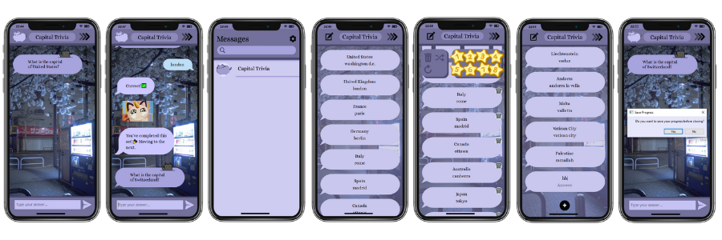

# Capital Trivia

Capital Trivia is a Python quiz app built with PyQt5 that helps users learn world capitals through a chat-style interface designed to look like a real phone.



## Features

- **Phone-style design:** A frameless window that you can drag anywhere on your screen. The close (×) and minimize (−) buttons in the top-right corner only appear when you hover over them, making the interface feel more like a real phone.
- **Chat-style quiz:** Answer questions through interactive chat bubbles.
- **Set-based learning:** Questions come in sets of 20, with incorrect answers repeated until answered correctly.
- **Saveable progress:** Saves quiz progress and question edits between sessions.
- **Question editor:** Add, edit, or delete questions.
- **Custom UI:** Chat bubbles, emotes, and decorative stars.

## Installation

**Requirements:** Python and pip.

Clone the repository:

```bash
git clone https://github.com/inanmaku/CapitalTrivia.git
cd CapitalTrivia
```

Install dependencies:

```bash
pip install -r requirements.txt
```

Run the app:

```bash
python main.py
```

## About the Project

I created Capital Trivia to practise Python and learn more about building desktop applications with PyQt5.

The stars started as an experiment with custom UI elements. They didn't serve a practical purpose, but I liked how they looked, so I kept them as decoration.
